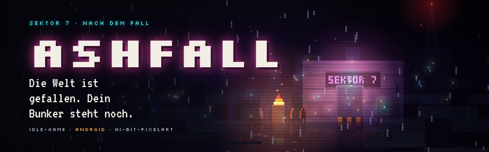
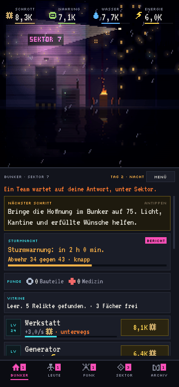
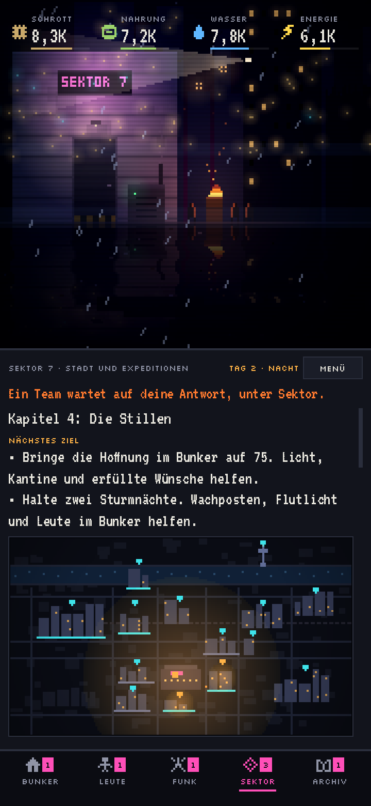
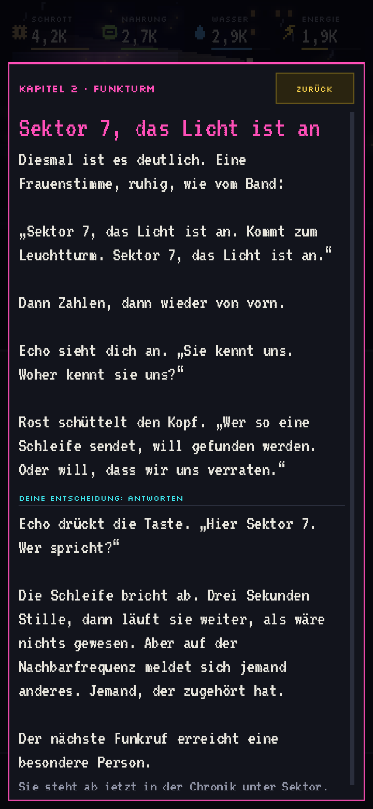
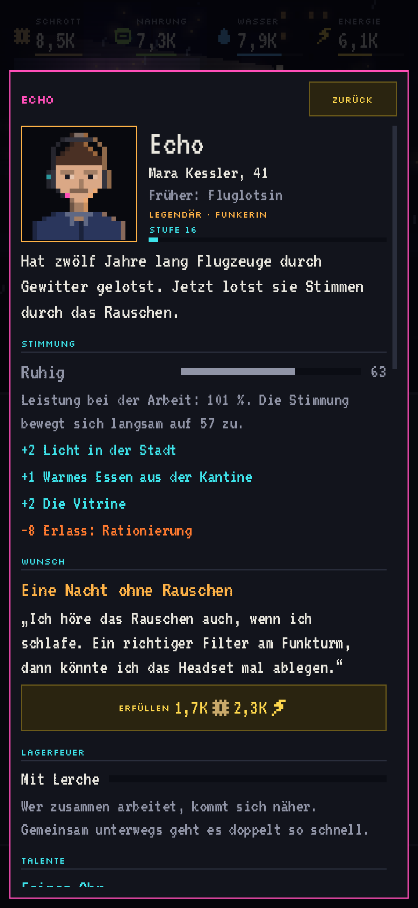
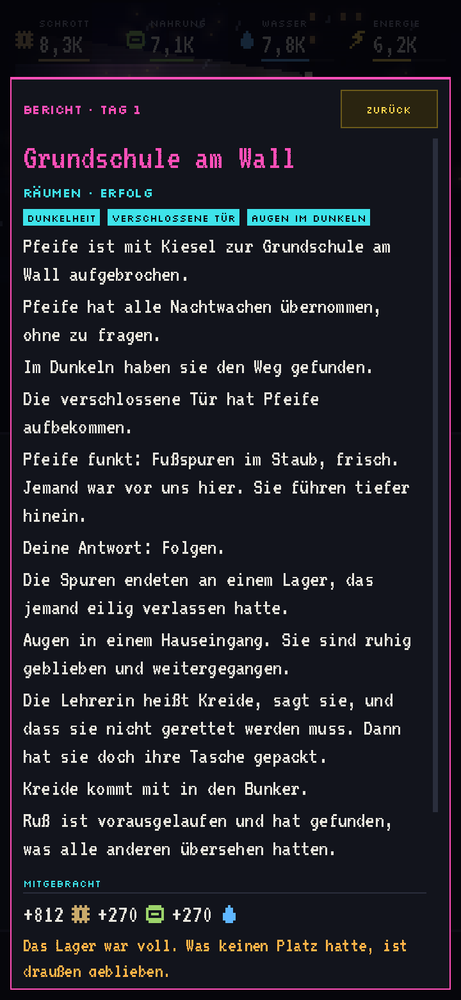
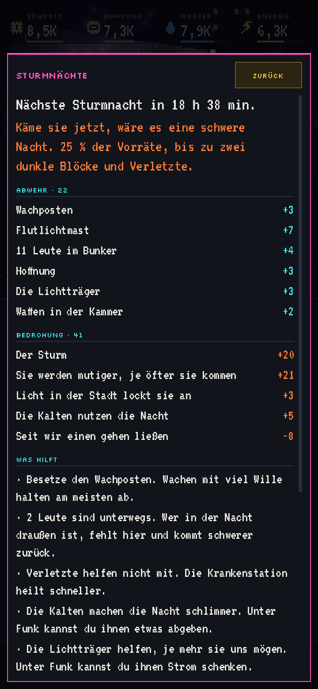
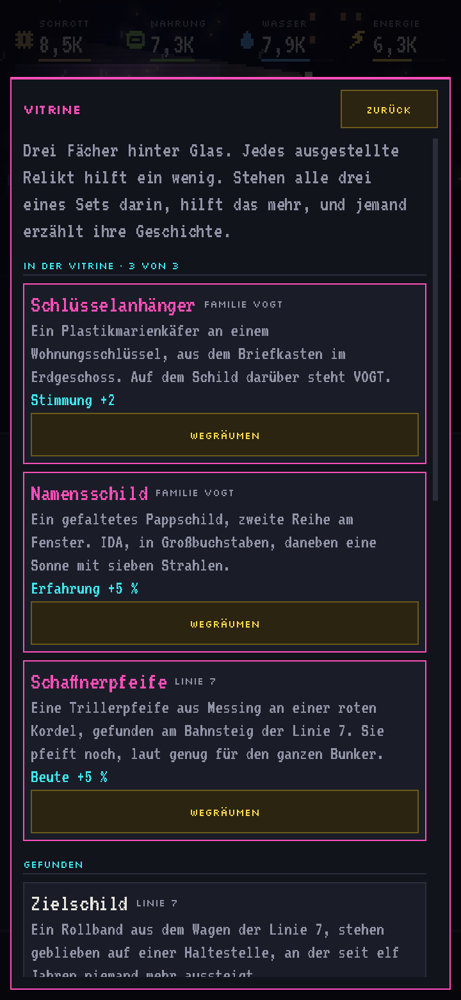
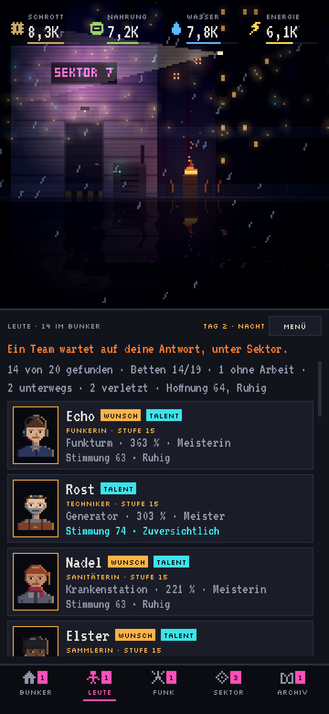

### Die Welt ist gefallen. Dein Bunker steht noch.

Ein Idle-Game für Android über einen Bunker in einer zerstörten Stadt, 
die Menschen darin und die Stimmen im Funk.

Der Bunker bei Nacht · Die Stadt auf der Karte · Ein Funkspruch · Echo, die Funkerin

## Was ist Ashfall?

Du führst einen Bunker in Sektor 7, einer Stadt nach dem Fall. Über Funk holst du Menschen zu dir, jede und jeder
mit Namen, Gesicht und eigener Geschichte. Du schickst Teams in die Ruinen, bringst Licht zurück in die Straßen und
hältst den Bunker durch die Sturmnächte. Er arbeitet weiter, während das Handy in der Tasche ist.

Und im Rauschen wartet eine Geschichte, Kapitel für Kapitel. Wer da draußen sendet und warum, erfährst du selbst.

## Das erwartet dich

- **Ein Bunker, der wächst:** 13 Gebäude von der Werkstatt über den Funkturm bis zum Labor. Schrott, Nahrung,
  Wasser und Energie fließen auch, wenn du nicht spielst, bis zu acht Stunden lang.
- **Menschen statt Einheiten:** 20 Überlebende mit Rufnamen, Porträt und Vergangenheit, dazu Ruß, der Bunkerhund.
  Sie haben Stimmungen und Wünsche, lernen Talente und kommen sich am Lagerfeuer näher.
- **Eine Geschichte über Funk:** 71 Funksprüche in bisher fünf Kapiteln. Manche verlangen eine Entscheidung, die
  für deinen Bunker gilt und verändert, wie es weitergeht.
- **Eine Stadt zum Zurückholen:** 16 Orte vom Wohnblock bis zur Oper. Expeditionen mit Etappen, Proviant und
  Ausrüstung bringen Beute, Funde und Dokumente heim. Jeder beleuchtete Ort hilft dem Bunker.
- **Sturmnächte:** Etwa einmal am Tag zieht ein Aschesturm auf. Du siehst genau, was die Abwehr ausmacht und was
  dagegen steht.
- **Kleine Schätze:** Ein tägliches Signal im Funk, Nadels Album mit allen Menschen und eine Vitrine für Relikte mit
  Geschichte.
- **Benachrichtigungen, wenn du willst:** Etwa wenn ein Team zurück ist oder ein Sturm aufzieht. Jeder Bereich lässt
  sich abschalten, nachts ist Ruhe.

Ein Expeditionsbericht · Die Sturmnacht · Die Vitrine · Die Leute im Bunker

## Fair gebaut

- **Kostenlos:** Keine Werbung, keine Käufe in der App, keine Lootboxen. Fortschritt kommt nur vom Spielen.
- **Kein Konto:** Keine Anmeldung, keine E-Mail-Adresse. Dein Spielstand liegt auf deinem Gerät.
- **Keine Datensammlung:** Ashfall schickt nichts über dich oder dein Spiel irgendwohin. Ins Internet geht die App
  nur, um nach Updates zu fragen und sie zu laden.
- **Zahlen statt Rätselraten:** Expeditionen zeigen ihre Aussicht in Prozent, die Sturmnacht jeden Posten ihrer
  Abwehr, und vor einer Entscheidung fragt das Spiel noch einmal nach.

## In zwei Minuten installiert

1. Öffne auf deinem Android-Gerät die [neueste Version](https://github.com/Labushuya/ashfall-releases/releases/latest)
   und tippe unter „Assets“ auf `ashfall-vX.Y.Z.apk`.
2. Öffne die heruntergeladene Datei. Beim ersten Mal fragt Android, ob dein Browser oder deine Dateien-App Apps
   installieren darf. Erlaube das, geh zurück und tippe auf „Installieren“.
3. Fragt Google Play Protect nach, liegt das daran, dass Ashfall nicht aus dem Play Store kommt. Du kannst die App
   prüfen lassen und dann installieren.
4. Fertig. Viel Glück da draußen.

## Updates und Spielstand

- **Updates kommen in der App:** Beim Start fragt Ashfall nach einer neuen Version und zeigt dir, was neu ist. Ein
  Tipp lädt das Update, Android fragt jedes Mal nach deiner Bestätigung. Von Hand geht es über Menü,
  „Nach Updates suchen“.
- **Dein Spielstand bleibt:** Bei jedem Update spielst du genau dort weiter, wo du warst.
- **Neues Handy:** Unter Menü, „Spielstand sichern oder laden“ kopierst du deinen Bunker als Code. Auf dem neuen
  Gerät lädst du ihn an derselben Stelle wieder.

## Häufige Fragen

<b>Gibt es Ashfall für das iPhone oder im Play Store?</b>

Nein, im Moment gibt es Ashfall nur für Android, als Download von dieser Seite. Eine Version im Google Play Store ist
geplant.

<b>Brauche ich Internet zum Spielen?</b>

Nein. Ashfall läuft komplett auf deinem Gerät. Nur die Suche nach Updates und der Download brauchen eine Verbindung.

<b>Was passiert, wenn ich ein paar Tage nicht spiele?</b>

Der Bunker arbeitet bis zu acht Stunden ohne dich weiter und wartet danach. Niemand verlässt ihn, weil du weg
warst. Was nicht mehr ins Lager passt, bleibt allerdings draußen, und Sturmnächte kommen auch ohne dich. Wenn du
Benachrichtigungen erlaubst, warnt Ashfall vorher.

<b>Ist die Datei sicher?</b>

Jede Version ist mit demselben Schlüssel signiert. Android installiert ein Update nur, wenn die Signatur zur
installierten App passt. Zu jeder Version stehen außerdem die SHA-256-Prüfsumme in den Release-Notizen und eine eigene
Datei `.sha256`. Lade Ashfall nur von dieser Seite.

<b>Ich habe einen Fehler gefunden. Was nun?</b>

Unter Menü, Fehlersuche tippst du auf „Fehlerbericht kopieren“. Der Bericht enthält Gerät, Version, die letzten
Ereignisse im Spiel und deinen Spielstand, sonst nichts, und wird nie von selbst verschickt. Schick ihn an die Person,
von der du Ashfall hast. Sie leitet ihn weiter.

<b>In welcher Sprache ist Ashfall?</b>

Auf Deutsch, alle Texte und Funksprüche.

---

## Was als Nächstes kommt

Ashfall wächst in kleinen Schritten. Jede Neuerung wird im Spiel erklärt, wenn sie ankommt. Die Reihenfolge kann
sich noch ändern.

<!-- vorschau:start -->
| Version | Was kommt |
|---|---|
| 0.8.5 | **Die Karawane:** Alle zwei bis drei Tage steht ein Händler am Tor, mit Angeboten, die es sonst nicht gibt |
| 0.8.6 | **Erfolge:** Die Stadt gibt dem Bunker Namen für das, was er schafft |
| 0.8.7 | **Flocke, die Bunkerkatze:** Seit die Kantine kocht, kommen Ratten. Und dann sitzt da eines Morgens jemand im Regal |
| 0.8.8 | **Boni auf einen Blick und mehr Funk:** Alles, was dem Bunker hilft, an einem Ort und in echten Zahlen, dazu neue Funksprüche unterwegs |
| 0.9.0 | **Die Tür:** Das Ende von Sektor 7, mit einer letzten Entscheidung und drei Enden |
| 0.9.1 | **Weiterziehen:** Mit Erinnerungen und Veteranen in einen neuen Sektor |
| 1.0.0 | **Google Play:** Ashfall im Play Store |
<!-- vorschau:end -->

## Versionen

<!-- versionen:start -->
| Version | Erschienen | Neu |
|---|---|---|
| [0.8.4](https://github.com/Labushuya/ashfall-releases/releases/tag/v0.8.4) | 20. Oktober 2026 | Relikte |
| [0.8.3](https://github.com/Labushuya/ashfall-releases/releases/tag/v0.8.3) | 19. Oktober 2026 | Das Album · Behoben |
| [0.8.2](https://github.com/Labushuya/ashfall-releases/releases/tag/v0.8.2) | 11. Oktober 2026 | Tagessignal · Expeditionen · Fehlersuche |
| [0.8.1](https://github.com/Labushuya/ashfall-releases/releases/tag/v0.8.1) | 10. Oktober 2026 | Benachrichtigungen · Expeditionen · Kleinigkeiten · Neues Symbol |
| [0.8.0](https://github.com/Labushuya/ashfall-releases/releases/tag/v0.8.0) | 10. Oktober 2026 | Menschen und Regeln · Aus euren Rückmeldungen |
<!-- versionen:end -->

Alle Versionen mit ihren Notizen stehen in [CHANGELOG.md](CHANGELOG.md), die Downloads unter
[Releases](https://github.com/Labushuya/ashfall-releases/releases).

## Technisches

| | |
|---|---|
| Plattform | Android 7.0 oder neuer, Handy und Tablet, Hochformat |
| Größe | unter 30 MB |
| Sprache | Deutsch |
| Internet | nur für Update-Suche und Download |
| Spielstand | auf dem Gerät, als Code übertragbar |
| App-Kennung | `de.labushuya.ashfall` |
| Engine | [Godot](https://godotengine.org) 4 |

**Berechtigungen und wofür sie da sind:**

- **Internet:** fragt hier nach neuen Versionen und lädt sie.
- **Apps installieren:** öffnet ein geladenes Update zur Installation. Android fragt jedes Mal nach.
- **Benachrichtigungen:** nur, wenn du zustimmst. Ashfall bietet sie einmal an, danach änderst du alles unter
  Menü, Einstellungen.
- **Nach dem Neustart starten:** stellt geplante Benachrichtigungen nach einem Neustart des Handys wieder ein.

## Was in diesem Repository liegt

| Datei | Inhalt |
|---|---|
| [README.md](README.md) | Diese Seite |
| [CHANGELOG.md](CHANGELOG.md) | Alle Versionen mit ihren Notizen, die neueste oben |
| [LICENSE](LICENSE) | Nutzungsbedingungen |
| [screens/](screens/) | Bilder aus dem Spiel |
| `banner.png`, `social-preview.png` | Banner und Vorschaubild für Links |
| [Releases](https://github.com/Labushuya/ashfall-releases/releases) | Je Version die App `ashfall-vX.Y.Z.apk`, ihre Prüfsumme und `latest.json`, mit der die App nach Updates fragt |

Der Quellcode von Ashfall ist nicht öffentlich. Dieses Repository enthält nur die offiziellen Downloads.

## Rechte und Danksagung

Copyright (c) 2026 Labushuya. Alle Rechte vorbehalten. Du darfst die offizielle App herunterladen, auf deinen
eigenen Geräten installieren und privat spielen. Alles Weitere regeln die [Nutzungsbedingungen](LICENSE).

Ashfall nutzt die Godot Engine unter der MIT-Lizenz und die Schriften Silkscreen und VT323 unter der SIL Open Font
License 1.1. Die vollständigen Lizenztexte stehen in der App unter Menü, „Lizenzen und Danksagung“.
